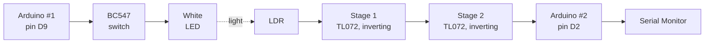

# Indoor Li-Fi Communication System

Send text from one Arduino to another using only visible light. An Arduino-driven white LED transmits Manchester-coded frames, and a receiver built from a light-dependent resistor (LDR) and two op-amp stages recovers them for a second Arduino, which prints the message on a laptop.

> **Status:** the full link works. The text `HELLO` is sent as light by Arduino #1 and decoded by Arduino #2 at 200 ms per bit (5 bit/s). The LDR sets the speed limit; scaling the link in speed and distance is the next phase.

## How it works



- **Transmitter.** Arduino #1 switches the LED through a BC547 transistor. Each bit is Manchester-coded: `1` = LED on then off, `0` = LED off then on, so every bit contains a mid-bit edge.
- **Frame.** 25 bits: preamble `10101010`, sync byte `01111110`, one data byte (MSB first), one even-parity bit. The line is dark between frames.
- **Receiver.** The LDR changes resistance with light. Stage 1 (inverting) turns that into a voltage, and stage 2 (inverting) restores the polarity, so the output is high when the LED is on. Arduino #2 reads it on pin D2.
- **Decoding.** The receiver waits for a long dark gap, locks onto the preamble, and re-synchronizes at every mid-bit edge, so the two Arduinos do not need a shared clock. It prints each decoded character on the Serial Monitor.

Details: [`docs/PROTOCOL.md`](docs/PROTOCOL.md), [`docs/DESIGN_CHOICES.md`](docs/DESIGN_CHOICES.md).

## Quick start

1. **Build the hardware** from [`docs/HARDWARE_CONNECTIONS.md`](docs/HARDWARE_CONNECTIONS.md). Parts are listed in [`docs/BOM.md`](docs/BOM.md).
2. **Flash the transmitter.** Open `firmware/lifi_tx/lifi_tx.ino` in the Arduino IDE, select *Arduino Uno* and its port, and upload to Arduino #1. It only needs power afterwards.
3. **Flash the receiver.** Upload `firmware/lifi_rx/lifi_rx.ino` to Arduino #2.
4. **Open the Serial Monitor** for Arduino #2 at **9600 baud**. You should see `Receiver ready`.
5. Point the transmitter LED at the LDR in a dim room. After a few seconds the letters appear: `Received: H`, `E`, `L`, `L`, `O`, repeating.

Both sketches use `BIT_US = 200000` (200 ms per bit). **The value must be identical in both files**, and both boards must run matching versions of the sketches.

If something goes wrong, see [`docs/PROBLEMS_AND_FIXES.md`](docs/PROBLEMS_AND_FIXES.md). The sketches in [`firmware/tools/`](firmware/tools) help check the wiring: `mirror_test` copies the receiver input to the on-board LED, and `edge_monitor` prints every edge it sees.

## Results so far

| Metric | Original target (photodiode design) | Result (LDR link) |
| --- | --- | --- |
| Bit rate | 2.4 kbps | 5 bit/s on the line; about 1.4 bit/s of payload |
| Range | 30 cm | [add distance tested] cm |
| Bit error rate | below 1% | not yet measured |
| Deliverable | single-byte message decoded repeatably | achieved: `HELLO` decoded |

The protocol was checked in simulation from 100 bps up to about 2.4 kbps (see [Simulation](#simulation)). The LDR, with rise and fall times in the tens of milliseconds, is why the hardware runs at 5 bit/s. Full results: [`docs/RESULTS.md`](docs/RESULTS.md).

## Repository layout

```
firmware/
  lifi_tx/lifi_tx.ino         Transmitter sketch (Arduino #1)
  lifi_rx/lifi_rx.ino         Receiver sketch (Arduino #2)
  tools/                      Wiring-check sketches (mirror_test, edge_monitor)
simulation/                   Software model that runs the real sketches (run_simulation.sh)
docs/
  PROTOCOL.md                 Frame format, line coding, receiver algorithm
  DESIGN_CHOICES.md           Why each design choice was made, including photodiode vs LDR
  HARDWARE_CONNECTIONS.md     Transmitter and receiver wiring, Arduino connections, power-up checklist
  BOM.md                      Bill of materials
  RESULTS.md                  Test results and timing
  PROBLEMS_AND_FIXES.md       What went wrong and how it was fixed
  ROADMAP.md                  Phases, next steps and risks
```

## Simulation

`simulation/run_simulation.sh` compiles the real `.ino` sketches against a small software model of the Arduino timing functions, records the transmitter's LED waveform, and replays it into the receiver with a mismatched clock, a random start point and optional LDR-like edge delays. It needs only a C++ compiler:

```bash
cd simulation
bash run_simulation.sh
```

It checks the protocol logic only. It does not model noise, LED rise time, amplifier settling or breadboard wiring.

## Known limitations

- **LDR speed** limits the link to a few bits per second.
- **Range and bit error rate** are not yet characterized.
- **Ambient light:** there is no AC coupling and the bias is fixed, so strong room light can hold the receiver on. Test in a dim room.
- **Level at D2:** the stage 2 output goes straight to Arduino pin D2. The pin tolerates about 5 V, so measure the level with a multimeter and add a divider if it is higher.
- The receiver needs a bench supply (12 V and 6 V), so it is not portable yet.
- One-way link, parity only, fixed test message.

## Roadmap

Phases 0 to 4 (scoping, transmitter, receiver, optical link, protocol on hardware) are done. Next: reliability, rate and range tuning (Phase 5), a Python logging interface (Phase 6), characterization (Phase 7), and a stretch phase that returns to a photodiode front end for kilobit rates. See [`docs/ROADMAP.md`](docs/ROADMAP.md).

## License

MIT. See [`LICENSE`](LICENSE).
